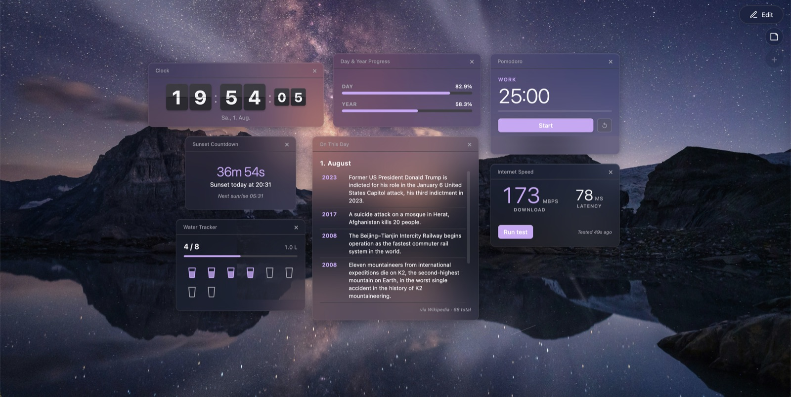
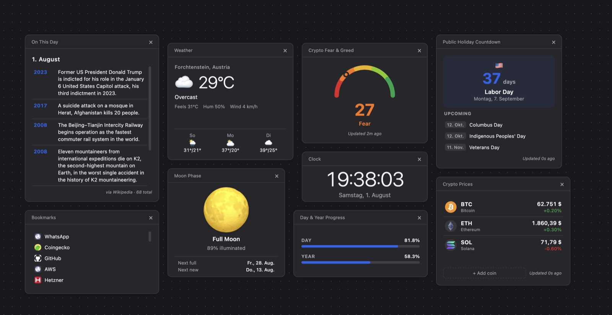
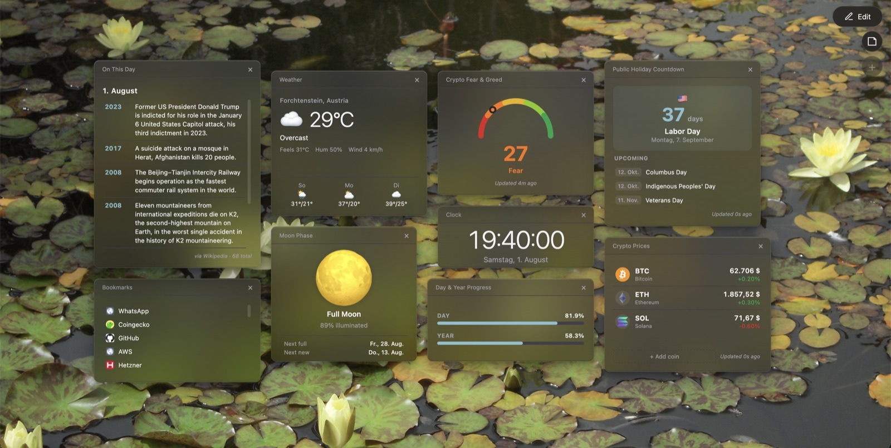
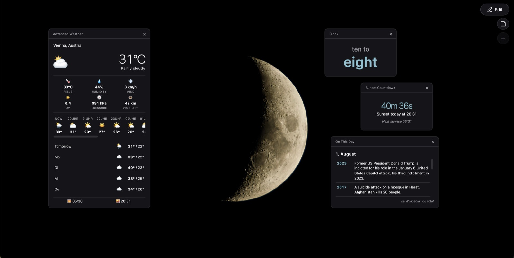

<div align="center">


# Tessra

**A fast, private new-tab dashboard for Firefox.**
Drag 50+ widgets onto a board, arrange them however you like, and theme the whole page.
No account, no tracking.

[](https://addons.mozilla.org/firefox/addon/tessra-custom-starting-page/)
[](https://addons.mozilla.org/firefox/addon/tessra-custom-starting-page/)
[](LICENSE)

[**Install for Firefox**](https://addons.mozilla.org/firefox/addon/tessra-custom-starting-page/) · [Website](https://tessra.0xsandro.net) · [Privacy](PRIVACY.md)

<br/>



</div>

## What it is

Tessra replaces Firefox's new tab (and, if you want, your homepage) with a board you build yourself. Pick widgets from a catalog, drop them anywhere, resize them, and style everything from one side panel. Everything you set up stays in your browser.

## Features

- **Free-form board.** Drag widgets anywhere, resize them, stack them, lock them, and rename them. Select several with a drag box and move, copy, duplicate, or delete them together.
- **Looks right on every screen.** The layout stays centered on any monitor, and the − / + buttons in the corner zoom around the center. Each screen remembers its own zoom level.
- **Themes.** Light and dark mode, one-click presets (Solarized, Tokyo Night, Nord, Catppuccin, Monochrome), flat, glass, or liquid surfaces, your own accent color, fonts (or upload one), and a dotted, solid, or image background.
- **Command palette.** Press <kbd>Ctrl</kbd>/<kbd>⌘</kbd> + <kbd>K</kbd> to search every widget and action.
- **Quiet when you want it.** Optionally hide all buttons until your pointer comes near them.
- **Share your setup.** Export a layout as a file, or copy it as a short text string someone else can paste in.
- **Guided tour** on first launch.

## Widgets

53 widgets, grouped the same way as in the catalog:

| Category | Widgets |
|---|---|
| **Time** | Clock (13 watch faces), World Clock, Alarms, Timer, Stopwatch, Pomodoro, Countdown, Day & Year Progress, Sunset Countdown, Public Holiday Countdown |
| **Productivity** | To-do, Notes, Sticky Note, Snippets, Clipboard, Reading List, Habit Tracker, Goal Tracker, Water Tracker, Counter, Calculator, Unit Converter, Color Palette |
| **Web** | Shortcuts, Bookmarks, Recent Tabs, Search |
| **Info** | Weather, Advanced Weather, Air Quality, Moon Phase, On This Day, Wikipedia Roulette, ISS Tracker, Internet Speed, Browser Stats, System Info |
| **Finance** | Crypto Prices, Crypto Fear & Greed, Stock Prices, ETFs, Forex, Commodities, Polymarket |
| **Developer** | GitHub Commits, GitHub Trending, Hacker News, JSON Formatter, Regex Tester, Markdown |
| **Random** | Coin Flip, Dice Roller, Lucky Wheel |

Notion widgets and a crypto chart are in the works.

## Screenshots

<table>
  <tr>
    <td></td>
    <td></td>
  </tr>
  <tr>
    <td align="center"><sub>Dark mode, flat surfaces</sub></td>
    <td align="center"><sub>Glass surfaces over your own photo</sub></td>
  </tr>
  <tr>
    <td colspan="2"></td>
  </tr>
  <tr>
    <td colspan="2" align="center"><sub>Or keep it minimal</sub></td>
  </tr>
</table>

## Privacy

Tessra has no server, no account, and no analytics.

- Your layout, theme, notes, to-dos, and settings live in your browser's local storage on your device.
- Widgets that need live data (weather, prices, GitHub, Wikipedia, and so on) request it directly from that service's public API, the same way a website would. Nothing passes through a Tessra server, because there isn't one.

[PRIVACY.md](PRIVACY.md) lists every service each widget can contact, and [PERMISSIONS.md](PERMISSIONS.md) explains why each browser permission is needed.

## Keyboard shortcuts

| Key | Action |
|---|---|
| <kbd>E</kbd> | Toggle edit mode |
| <kbd>P</kbd> | Open the side panel |
| <kbd>T</kbd> | Open the Theme tab |
| <kbd>Ctrl</kbd>/<kbd>⌘</kbd> + <kbd>K</kbd> | Command palette |
| <kbd>Ctrl</kbd>/<kbd>⌘</kbd> + <kbd>D</kbd> | Duplicate selected widgets |
| <kbd>Ctrl</kbd>/<kbd>⌘</kbd> + <kbd>C</kbd> / <kbd>V</kbd> | Copy / paste selected widgets |
| Arrow keys | Nudge selected widgets (hold <kbd>Shift</kbd> for bigger steps) |
| <kbd>Delete</kbd> / <kbd>Backspace</kbd> | Remove selected widgets |
| <kbd>Esc</kbd> | Clear the selection, then leave edit mode |

## Running it locally

There's no build step. Tessra is plain HTML, CSS, and JavaScript modules, so the files in this repo are exactly what runs.

**As an extension** (full feature set):

1. Open `about:debugging#/runtime/this-firefox` in Firefox.
2. Click **Load Temporary Add-on…** and pick `manifest.json` from this folder.
3. Open a new tab.

**As a plain page** (quick UI work): serve the folder and open `newtab.html`. Settings fall back to `localStorage`, and widgets that need browser APIs (bookmarks, tabs, history, top sites) show placeholders.

```bash
python3 -m http.server 8000
```

Then open <http://localhost:8000/newtab.html>.

### Project layout

```
manifest.json            Extension manifest (Firefox, Manifest V2)
newtab.html              The page, plus the side panel and popover markup
newtab.css               All styles
src/main.js              Board, drag and resize, edit mode, theme, side panel, saving
src/widget-registry.js   register() and the widget definition format
src/utils.js             escapeHtml() and isSafeUrl()
src/widgets/             One file per widget; index.js imports them all
src/widgets/watchfaces/  Clock faces
```

### Adding a widget

Create a file in `src/widgets/`, call `register()`, and import it from `src/widgets/index.js`. That's all `main.js` needs to know about it.

```js
// src/widgets/hello.js
import { register } from '../widget-registry.js';
import { escapeHtml } from '../utils.js';

register({
  type: 'hello',                         // unique, stored in saved layouts
  title: 'Hello',
  icon: '👋',
  category: 'random',
  defaultSize: { w: 240, h: 140 },
  defaultData: () => ({ clicks: 0 }),    // persisted content
  defaultSettings: () => ({ name: 'world' }),
  settingsSchema: [
    { key: 'name', type: 'text', label: 'Name' }
  ],
  render(body, ctx) {
    body.innerHTML = `<button class="btn-subtle">Hello, ${escapeHtml(ctx.settings.name)} (${ctx.data.clicks})</button>`;
    body.querySelector('button').addEventListener('click', () => {
      ctx.data.clicks++;
      ctx.save();
      ctx.rerender();
    });
  }
});
```

A few rules keep the extension safe and reviewable:

- Run any text from an API or an imported layout through `escapeHtml()` before putting it in `innerHTML`, and check links with `isSafeUrl()`.
- If the widget calls a new API, add its host to `permissions` in `manifest.json` and list it in `PRIVACY.md` and `PERMISSIONS.md`.
- No remote scripts. Everything the extension runs has to ship in this repo.

## Feedback

Found a bug or have an idea for a widget? [Open an issue](https://github.com/0xSandro/Tessra/issues), or reach me on X at [@0xSandro](https://x.com/0xSandro). Layouts people have built are always welcome too.

## License

[MIT](LICENSE) © Alessandro Steurer. Legal notice: [IMPRINT.md](IMPRINT.md).
